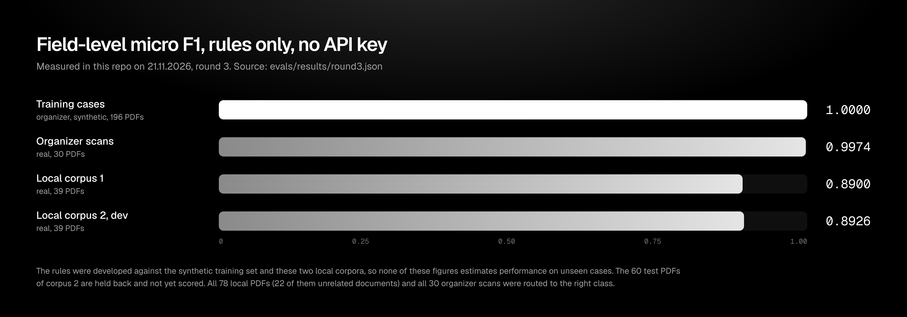
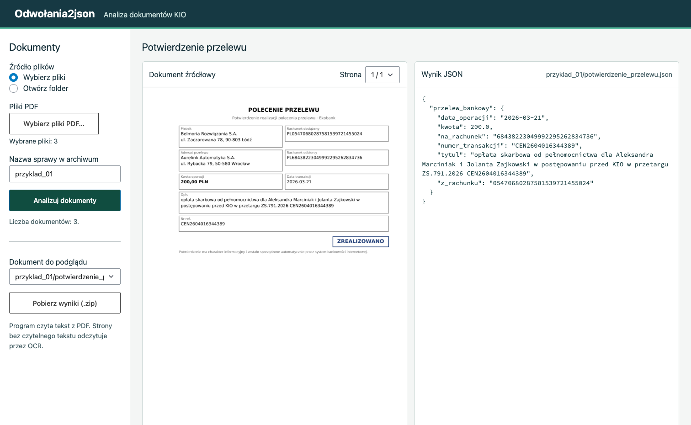

<p align="center">
  
</p>

<p align="center">
  <a href="https://doc2json.pl"><b>doc2json.pl</b></a> ·
  <a href="#quick-start">Quick start</a> ·
  <a href="#how-it-works">How it works</a> ·
  <a href="#results">Results</a> ·
  <a href="docs/readme/reference.md">Technical reference</a>
</p>

doc2json is our HackNation 2026 entry for the Odwołania2json challenge of the Public Procurement Office (UZP). Give it
the PDFs of a KIO appeal case. It decides from the content which file is the appeal, the power of attorney or the
transfer confirmation, and writes the organizer's JSON for each one. Any other document gets an empty file.

<p align="center">
  <a href="https://doc2json.pl"></a>
</p>

## The problem

An appeal case is a handful of PDFs, some exported from a word processor and some scanned. Each repeats the same
facts in different words: the parties and their identifiers, the procurement, the contested action and the paid fee.
A person reads them easily, but a system can only use those facts once they are structured data.
<sub>Source: challenge description, UZP, HackNation 2026 (`docs/task/`).</sub>

<p align="center"></p>

## How it works

<p align="center"></p>

- Routing reads the text of each PDF and never its file name, so `scan001.pdf` is handled like `odwolanie.pdf`.
- A value the document does not state is `null`. Output from an optional model is kept only when it cites a
  supporting span of the source.
- It runs on the jury's laptop: CPU only, offline OCR, installed with `pip install -r requirements.txt`. The
  default configuration needs no API key and calls no language model, because extraction is rules plus local OCR.
  An optional OpenAI-compatible endpoint is described in
  [Use a model endpoint](docs/readme/reference.md#use-a-model-endpoint).
- Each document class is one TOML file in `config/classes/` with its routing cues, fields and engines. The disabled
  fourth class shows how: [enable it](docs/readme/reference.md#enable-the-fourth-class).

## Results

<p align="center"></p>

| Dataset | PDFs | Micro F1 | Appeal | Power of attorney | Transfer |
|---|---:|---:|---:|---:|---:|
| Organizer training cases (synthetic) | 196 | 1.0000 | 1.0000 | 1.0000 | 1.0000 |
| Organizer scans (real) | 30 | 0.9974 | 1.0000 | 1.0000 | 0.9833 |
| Local corpus 1 (real) | 39 | 0.8900 | 0.9069 | 0.9558 | 0.7037 |
| Local corpus 2, dev (real) | 39 | 0.8926 | 0.8783 | 0.9895 | 0.8833 |

Each figure is a rules-only CLI run (no endpoint configured), recorded in
[`evals/results/round3.json`](evals/results/round3.json). The rules were developed against the training cases and the
two local corpora, which are private sets of real documents that are not in this repository. These are therefore
development figures, not estimates for unseen cases and not the score on the organizer's hidden test set. The 60 test
PDFs of corpus 2 are held back and have not been scored.

The F1 comes from this repository's scorer, `evals/metrics.py`, not from the organizer's, which we do not have.
A batch of 150 PDFs took 83 s with four workers on a busy host, with load averages of 24 to 38 recorded around the run
(`timing` in `round3.json`). The organizer's limit for 150 PDFs is 45 minutes ([`data/uzp/README.md`](data/uzp/README.md)). Method, timings and the OCR comparison are in the
[technical reference](docs/readme/reference.md#results-on-the-training-data-synthetic). Full training run:
[`latest.json`](evals/results/latest.json).

## Quick start

Python 3.13, 64-bit. From the repository root:

```bash
python3.13 -m venv .venv && . .venv/bin/activate      # Windows: py -3.13 -m venv .venv; .\.venv\Scripts\Activate.ps1
python -m pip install -r requirements.txt
python -m kio2json                                    # reads ./input/<case>/*.pdf, writes ./output/<case>/*.json
```

| | Windows | Linux or macOS |
|---|---|---|
| CLI on `input/` → `output/` | `.\start.bat` | `./start.sh` |
| Local viewer in the browser (127.0.0.1:8000): pages next to the JSON | `.\start.bat gui` | `./start.sh gui` |
| Web app | [doc2json.pl](https://doc2json.pl) | [doc2json.pl](https://doc2json.pl) |

<p align="center">
  
  
</p>

OCR engines, offline install of the language data, the optional model endpoint and every setting are in the
[technical reference](docs/readme/reference.md#run).

## Add a document type

```toml
# config/classes/receipt.toml
id = "receipt"
engines = ["labelled_fields"]

[routing]
required = ['^Receipt$', '^Reference:']

[fields.reference]
type = "string"
instruction = "Reference printed on the receipt."
pattern = '^Reference:[ \t]*(.+)$'
```

A class like this needs no code change and no rebuild. Field types, lists, normalisers and model engines:
[Add a class](docs/readme/reference.md#add-a-class). The three organizer classes use the same keys, explained in
[The bundled classes](docs/readme/reference.md#the-bundled-classes).

## Repository

| Path | What is there |
|---|---|
| `kio2json/` | The extractor: PDF text and OCR, routing, rule extractors, optional model engine, CLI and viewer |
| `config/classes/` | One TOML per document class |
| `evals/` | Field-level F1 harness and recorded results |
| `frontend/`, `docs/deploy.md` | The doc2json.pl page and how it is deployed |
| `data/uzp/` | Organizer data and schemas (copy of their repository) |
| `docs/task/` | Challenge brief, FAQ and details |
| `WORKLOG.md` | Current state, open work and the dated log |
