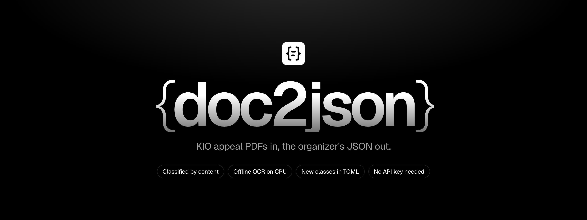

<p align="center">
  
</p>

<p align="center">
  <a href="https://doc2json.pl"><b>doc2json.pl</b></a> ·
  <a href="#quick-start">Quick start</a> ·
  <a href="#how-it-works">How it works</a> ·
  <a href="#results">Results</a> ·
  <a href="docs/readme/reference.md">Technical reference</a>
</p>

doc2json is our HackNation 2026 entry for the Odwołania2json challenge of the Public Procurement Office (UZP). Give it
the PDFs of a KIO appeal case. It decides from the content which file is the appeal, the power of attorney or the
transfer confirmation, and writes the organizer's JSON for each one. Any other document gets `{}`, as UZP confirmed in
[issue #57](https://github.com/00200200/HackNation2026-2/issues/57).

<p align="center">
  <a href="https://doc2json.pl"></a>
</p>

## The problem

An appeal case is a handful of PDFs, some exported from a word processor and some scanned. Each repeats the same
facts in different words: the parties and their identifiers, the procurement, the contested action and the paid fee.
A person reads them easily, but a system can only use those facts once they are structured data.
<sub>Source: challenge description, UZP, HackNation 2026 (`docs/task/`).</sub>

<p align="center"></p>

## How it works

<p align="center"></p>

- Routing reads the text of each PDF and never its file name, so `scan001.pdf` is handled like `odwolanie.pdf`.
- A value the document does not state is `null`. Output from an optional model is kept only when it cites a
  supporting span of the source.
- It needs no GPU: OCR runs offline on the CPU. The default configuration needs no API key and calls no language
  model, because extraction is rules plus local OCR. The optional model profile we measured calls Mistral's
  open-weight `ministral-3b-2512` (3,849,090,048 parameters) through the regional endpoint `api.eu.mistral.ai`. Its
  documented processing geography includes EU and EFTA countries, so a narrower location commitment is still open; see
  [Use a model endpoint](docs/readme/reference.md#use-a-model-endpoint).
- Each document class is one TOML file in `config/classes/` with its routing cues, fields and engines. The disabled
  fourth class shows how: [enable it](docs/readme/reference.md#enable-the-fourth-class).
- The pipeline diagram is also available as a [PDF](docs/pipeline/pipeline.pdf).

## Results

<p align="center"></p>

| Dataset | PDFs | UZP micro F1 | Strict micro F1 |
|---|---:|---:|---:|
| Organizer training cases (synthetic) | 196 | 1.0000 | 1.0000 |
| Organizer scans (scanned PDFs) | 30 | 1.0000 | 0.9974 |
| Local corpus 1 (real) | 39 | 0.9212 | 0.8880 |
| Local corpus 2, dev (real) | 39 | 0.9244 | 0.8951 |

Each row is one rules-only CLI run (no API key, two PDF workers) recorded in
[`evals/results/p0-conventions.json`](evals/results/p0-conventions.json). The training and scan rows are product commit
`97dc53e` (`final_verification`). The corpus rows are the earlier product commit `55dc2a1` (`integration.corpus1all` and
`integration.corpus2`, where `micro_f1` is the UZP score and `micro_f1_strict` the strict one), because the private
corpora were not re-run at `97dc53e`, whose code differs. Since `97dc53e`, main has changed the extractor only through
the first-pass watchdog (#79) and the vendored OCR data (#54), which that file does not cover.

UZP micro F1 follows the scoring rules UZP gave on the hackathon Discord, as recorded in
[issue #59](https://github.com/00200200/HackNation2026-2/issues/59) and implemented in `evals/metrics.py`: a field that is
empty in both the reference and the prediction counts as zero, and a wrong value counts as one false positive. Five long
strings accept an 80% RapidFuzz match, because UZP has not confirmed its similarity function. The strict score, a
normalised exact match, is the one we used before.

UZP answered that a transfer account keeps the printed country code
([issue #58](https://github.com/00200200/HackNation2026-2/issues/58)). The original training references omit two printed
`PL` prefixes in each of 48 transfers, so the training row scores against references with them restored
(`--correct-training-accounts`). Against the original references the same outputs score 0.9758 UZP and 0.9585 strict, with
96 field mismatches (`integration.training_raw`). On the organizer scans no field is missing or wrong under the UZP rules
(309 true positives, 0 false positives, 0 false negatives, `integration.scans.field_counts`). An earlier run at extractor
`f7f3ee9` ([`uzp-metric.json`](evals/results/uzp-metric.json)), which predates #65, routed one transfer scan wrongly and
scored 0.9869 UZP and 0.9740 strict on them. We have not established whether #65 explains the difference.

The rules were developed against the training cases, the organizer scans and the two local corpora. The local corpora are
private sets of real documents that are not in this repository. These are therefore development figures, not estimates
for unseen cases and not the score on the organizer's hidden test set. The 60 test PDFs of corpus 2 are not part of them.

Timing: with the 180-second primary watchdog (`watchdog_commit` `21f55e0`), two workers processed all 226 public PDFs in
160.75 s on a shared Apple M1 ([`first-pass-watchdog.json`](evals/results/first-pass-watchdog.json),
`public_batch.watchdog.wall_seconds`, 160.753). The one-minute load average of the host was 34.65 at the start and 32.54
at the end (`public_batch.watchdog.load_average_1min_start` and `load_average_1min_end`). In an earlier stress run, 150
PDFs took 402 s with one worker while eight busy loops occupied the 8 logical CPUs
([`adaptive-ocr-budget.json`](evals/results/adaptive-ocr-budget.json), `runs[5]`, product `59aa13a`). That run preceded
the final change to optional page reads, and the test suite ran during part of it (`serial_measurement`). The organizer
allows 45 minutes ([`data/uzp/README.md`](data/uzp/README.md)), and the jury's machine will differ from ours.

The definition of the score, the earlier rounds and the OCR comparison are in the technical reference:
[current figures](docs/readme/reference.md#current-figures-uzp-micro-f1-rules-only),
[real-document rounds and timings](docs/readme/reference.md#rules-on-real-documents-and-organizer-scans) and
[OCR comparison](docs/readme/reference.md#ocr-on-real-development-documents). Known limits and unconfirmed organizer
details: [known limits](docs/readme/reference.md#known-limits). Full training run:
[`latest.json`](evals/results/latest.json).

## Quick start

Python 3.13, 64-bit. From the repository root:

```bash
python3.13 -m venv .venv && . .venv/bin/activate      # Windows: py -3.13 -m venv .venv; .\.venv\Scripts\Activate.ps1
python -m pip install -r requirements.txt
python -m kio2json                                    # reads ./input/<case>/*.pdf, writes ./output/<case>/*.json
```

| | Windows | Linux or macOS |
|---|---|---|
| CLI on `input/` → `output/` | `.\start.bat` | `./start.sh` |
| Local viewer in the browser (127.0.0.1:8000): pages next to the JSON, and a warning when the documents of one case disagree | `.\start.bat gui` | `./start.sh gui` |
| Web app | [doc2json.pl](https://doc2json.pl) | [doc2json.pl](https://doc2json.pl) |

<p align="center">
  
  
</p>

`requirements.txt` lists only pinned PyPI packages, so pip downloads only from `pypi.org` and `files.pythonhosted.org`.
The Polish and English OCR data ship in the repository (`kio2json/tessdata/`), and the rules-only CLI and viewer process
PDFs offline after the install. OCR engines, the optional model endpoint and every setting are in the
[technical reference](docs/readme/reference.md#run).

## Run with Docker Compose

Install Docker with Compose v2.24 or later. From the repository root, place case PDFs in
`input/<case>/` or use the bundled `input/case1/`, then run:

```sh
docker compose run --rm cli
```

The first build downloads the Python dependencies from PyPI. The Polish and English OCR data ship in the repository
(`kio2json/tessdata/`), so nothing else is fetched.
Each input PDF gets a matching file under `output/<case>/`. To upload PDFs in a browser, run:

```sh
docker compose up gui
```

Open <http://127.0.0.1:8000> for the upload page or <http://127.0.0.1:8000/api/docs> for
the API. Press Ctrl+C to stop the server. Both services use local extraction by default.
To enable a model, copy `.env.example` to `.env`, fill in the three endpoint settings,
and rerun the service. Keep the key in the ignored `.env` file.

Both services read the host's `config/classes/` directory. See the
[pipeline architecture](docs/readme/reference.md#how-it-works),
[class configuration example](docs/readme/reference.md#enable-the-fourth-class)
and [instructions for adding a class](docs/readme/reference.md#add-a-class). The handover requirements are in
[§3.5 of the task rules](docs/task/regulamin.pdf).

## Deploy on the evaluation VM

UZP runs the command from `RUN.md` in `/opt/solution` on a Linux VM, without the team present, after it cuts the team's
access at 11:00 on 22.11.2026 ([`data/uzp/VM.md`](data/uzp/VM.md)). `deploy/vm_setup.sh` installs the pinned requirements
and smoke-tests a transfer and a scanned appeal, and `deploy/RUN.md` is the command we hand over. The steps, the offline
rehearsal and the Docker Compose fallback are in
[Deploy on the evaluation VM](docs/readme/reference.md#deploy-on-the-evaluation-vm). The Ubuntu 24.04 offline run with
two CPUs is recorded as unverified in [`vm-2vcpu.json`](evals/results/vm-2vcpu.json), because Docker Desktop did not
respond on the development host.

## Add a document type

```toml
# config/classes/receipt.toml
id = "receipt"
engines = ["labelled_fields"]

[routing]
required = ['^Receipt$', '^Reference:']

[fields.reference]
type = "string"
instruction = "Reference printed on the receipt."
pattern = '^Reference:[ \t]*(.+)$'
```

A class like this needs no code change and no rebuild. Field types, lists, normalisers and model engines:
[Add a class](docs/readme/reference.md#add-a-class). The three organizer classes use the same keys, explained in
[The bundled classes](docs/readme/reference.md#the-bundled-classes).

## Repository

| Path | What is there |
|---|---|
| `kio2json/` | The extractor: PDF text and OCR, routing, rule extractors, optional model engine, CLI and viewer |
| `config/classes/` | One TOML per document class |
| `evals/` | Field-level F1 harness and recorded results |
| `compose.yaml`, `api.Dockerfile` | Docker Compose services for the batch CLI and the local upload page |
| `frontend/`, `docs/deploy.md` | The doc2json.pl page and how it is deployed |
| `deploy/` | VM setup script, handover `RUN.md`, offline rehearsal and the Compose file for the VM |
| `data/uzp/` | Organizer data and schemas (copy of their repository) |
| `docs/task/` | Challenge brief, FAQ and details |
| `WORKLOG.md` | Current state, open work and the dated log |
