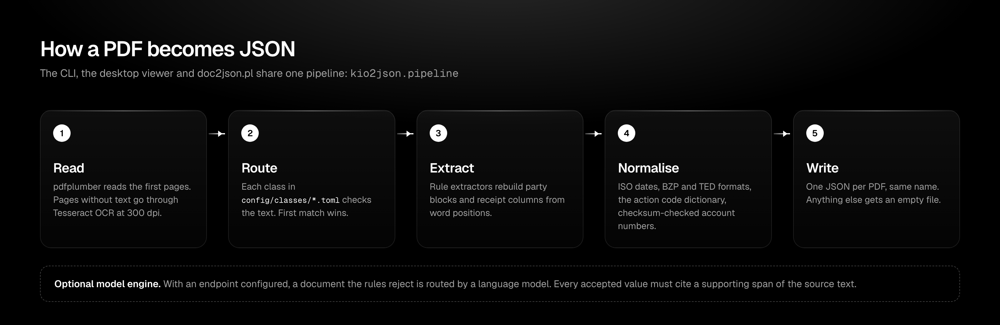
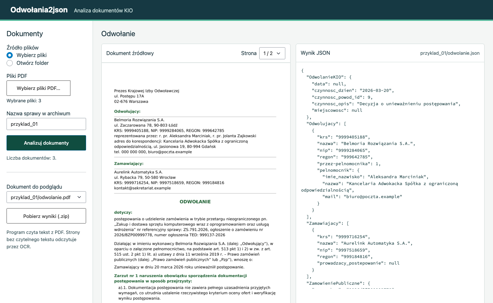

<p align="center">
  
</p>

<p align="center">
  <a href="https://doc2json.pl"><b>doc2json.pl</b></a> ·
  <a href="#quick-start">Quick start</a> ·
  <a href="#how-it-works">How it works</a> ·
  <a href="#results">Results</a> ·
  <a href="docs/readme/reference.md">Technical reference</a>
</p>

HackNation 2026 entry for the **Odwołania2json** challenge of the Public Procurement Office (UZP). Drop the PDFs of a
KIO appeal case in. doc2json works out which file is the appeal, the power of attorney and the transfer
confirmation from their content, and writes the organizer's JSON for each one. For an unrelated document it writes `{}`.

<p align="center">
  <a href="https://doc2json.pl"></a>
</p>

## The problem

A KIO case can include an appeal, a power of attorney and a payment receipt. Each describes a different part of the same proceeding. The extractor reads native text and scans, identifies the document type and writes the fields UZP asks for. [Task brief](docs/task/BRIEF.md)

<p align="center"></p>

## How it works

<p align="center"></p>

The CLI reads and routes each document locally, then runs the rules for that class. On the jury VM, Ministral can fill a field the rules left null using a verbatim quote from the document. Every value the rules supplied is final. The CLI checks the evidence against the field and its owner. Missing scalar values can remain `null`. [Pipeline](docs/pipeline/pipeline.pdf) · [Model configuration](docs/readme/reference.md#use-a-model-endpoint)

## Results

The jury profile report compares local rules and Ministral on the same organizer documents. It includes the original and printed-account scoring conventions, API calls, and batch timings. [Jury profile measurements](evals/results/jury-keyed-profile.md)

These field scores come from the keyless CLI on merged main at `725765b`, with two workers. Both private corpora contain real documents and are not distributed. [Merged-main measurements](evals/results/merged-main-725765b.json)

| Dataset | PDFs | UZP micro F1 | Strict micro F1 |
|---|---:|---:|---:|
| Organizer synthetic training, printed account prefixes | 196 | 1.0000 | 1.0000 |
| Organizer scans | 30 | 1.0000 | 0.9974 |
| Fixed synthetic layout variants | 240 | 0.9512 | 0.9264 |
| Case-linked synthetic documents, development | 112 | 0.9729 | 0.9667 |
| Case-linked synthetic documents, reserved | 96 | 0.7923 | 0.7705 |
| Private corpus 1, development | 22 | 0.9286 | 0.8821 |
| Private corpus 2, development | 39 | 0.9244 | 0.8951 |

On organizer scans, 29 of 30 outputs matched the reference JSON exactly, including after a serial retry of the remaining scan. A separate mixed batch of 90 native PDFs and two copies of the 30 scans took 343.53 seconds, with 148 of 150 outputs exact. UZP allows approximate matches on five long fields. The UZP column uses normalized Levenshtein similarity for those fields. The strict column uses the project's earlier scoring method. [Batch results](evals/results/merged-main-725765b.json) · [Scoring rules](https://github.com/00200200/HackNation2026-2/issues/59)

Each case-linked document has a native and a scanned rendering. The receipt router at `b5cdc5b` recognized all four development bank letters. On a second blind evaluation of the reserved split, correct routes rose from 82 to 88 of 96 and UZP F1 rose from 0.7923 to 0.8159. The six newly routed PDFs comprised two transaction histories, two operation details and two order details. Each still had field errors. Exact outputs stayed at 41 of 96. [Case scores](evals/results/case-transfer-routing.json)

On eight reserved synthetic sole-trader mandates, the grantor reader recovered all eight personal names and tax IDs. It missed the business and signer names on all eight. [Grantor field results](evals/results/sole-trader-grantors.md)

On five held-out cases in a separate ten-appeal, two-column benchmark, field F1 was 0.9700 with native text and 0.8925 with forced OCR. Unlabelled procurement titles remained missing. [Two-column results](evals/results/two-column-appeals.json) · [Pipeline diagram (PDF)](docs/pipeline/pipeline.pdf)

## Quick start

Install 64-bit Python 3.13. From the repository root, create and activate a virtual environment.

| Shell | Create | Activate |
|---|---|---|
| PowerShell | `py -3.13 -m venv .venv` | `.\.venv\Scripts\Activate.ps1` |
| macOS or Linux | `python3.13 -m venv .venv` | `. .venv/bin/activate` |

Place PDFs under `input/<case>/`, then run the following commands. The CLI writes the matching JSON files under `output/<case>/`.

```sh
python -m pip install -r requirements.txt
python -m kio2json
```

| | Windows | Linux or macOS |
|---|---|---|
| CLI on `input/` → `output/` | `.\start.bat` | `./start.sh` |
| Local viewer in the browser (127.0.0.1:8000): pages next to the JSON | `.\start.bat gui` | `./start.sh gui` |
| Web app | [doc2json.pl](https://doc2json.pl) | [doc2json.pl](https://doc2json.pl) |

<p align="center">
  
  
</p>

OCR engines, offline install of the language data, the optional model endpoint and every setting are in the
[technical reference](docs/readme/reference.md#run).

## Deploy on the evaluation VM

The setup script installs the jury CLI in `/opt/solution`. The evaluator runs the two-worker command in `RUN.md` from that directory. Before handover, the deployment owner sets `KIO_LLM_API_KEY` in `/opt/solution/.env` alongside `KIO_LLM_BASE_URL=https://api.eu.mistral.ai/v1` and `KIO_LLM_MODEL=ministral-3b-2512`. The same command uses local rules when the key is absent and preserves their output if a model call fails. [Jury command](deploy/RUN.md) · [VM setup and rehearsal](docs/readme/reference.md#deploy-on-the-evaluation-vm)

The jury model has 3.85 billion parameters, including its vision weights. Mistral lists EU and EFTA data centers for its regional inference service. The exact country serving this model is unconfirmed. [Model size](docs/small-model-providers.md) · [Regional inference](https://docs.mistral.ai/inference/regional-inference) · [Privacy policy](https://legal.mistral.ai/terms/privacy-policy/) · [Data Processing Addendum](https://legal.mistral.ai/terms/data-processing-addendum/)

## Run with Docker Compose

Run `docker compose run --rm cli` for the batch or `docker compose up gui` for the local upload page. [Compose setup](docs/readme/reference.md#run-with-docker-compose)

## Add a document type

```toml
# classes/receipt.toml
id = "receipt"
engines = ["labelled_fields"]

[routing]
required = ['^Receipt$', '^Reference:']

[fields.reference]
type = "string"
instruction = "Reference printed on the receipt."
pattern = '^Reference:[ \t]*(.+)$'
```

Save this file as `classes/receipt.toml` and run `python -m kio2json --classes classes --input input --output output`. Add `--explain trace` to record the routing decision and field sources separately. The reference shows how to generate a class from a sample PDF and configure field checks.
[Add a class](docs/readme/reference.md#add-a-class).

## Repository

| Path | What is there |
|---|---|
| `kio2json/` | The extractor: PDF text and OCR, routing, rule extractors, optional model engine, CLI and viewer |
| `config/classes/` | One TOML per document class |
| `evals/` | Field-level F1 harness and recorded results |
| `frontend/`, `docs/deploy.md` | The doc2json.pl page and how it is deployed |
| `data/uzp/` | Organizer data and schemas (copy of their repository) |
| `docs/task/` | Challenge brief, FAQ and details |
| `WORKLOG.md` | Current state, open work and the dated log |
